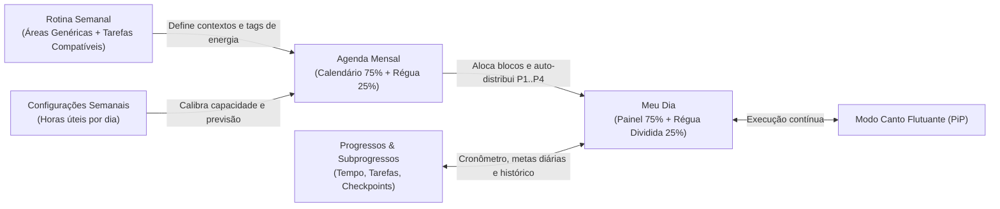

<div align="center">

# 🌸 Rascunho

**Planejamento temporal acolhedor, rotina por níveis de energia e gestão de metas anti-burnout em _Cozy Pastel Dark Mode_.**

<p>
  
  
  
  
  
  
  <a href="LICENSE">
    
  </a>
</p>

<p>
  <a href="#-sobre-o-projeto">Sobre</a> •
  <a href="#-as-3-tags-de-energia">Tags de Energia</a> •
  <a href="#-visão-geral-dos-módulos">Módulos</a> •
  <a href="#-régua-vertical-interativa">Régua Vertical</a> •
  <a href="#-design-system">Design System</a> •
  <a href="#-arquitetura--persistência">Arquitetura</a> •
  <a href="#-squad-multi-agente">Squad</a> •
  <a href="#-como-executar">Como Executar</a>
</p>

</div>

---

## ✨ Sobre o Projeto

O **Rascunho** é uma aplicação web **Desktop-First** de organização pessoal e gestão de tempo pensada para equilibrar produtividade e saúde mental. Em vez de tratar o dia como uma lista rígida e punitiva de compromissos, o sistema separa **contextos recorrentes**, **blocos práticos de execução** e **metas contínuas**, avaliando o tempo livre real antes que a sobrecarga aconteça.

> [!NOTE]
> **Princípio Central — Separação sem Ambiguidades:**
> - **Áreas da Rotina** definem _contextos ou partes do dia_ em baixa opacidade no fundo da grade (sem virarem tarefas soltas nem blocos de cronômetro).
> - **Blocos de Atividade** representam _alocações práticas_ criadas por arraste na régua vertical da **Agenda** ou do **Meu Dia**, vinculadas a um **Progresso** ou a uma **Tarefa**.
> - **Adaptações Pontuais** permitem ajustar as áreas e atividades de um dia específico (`dayOverrides`) sem deformar a sua rotina semanal base.



---

## ⚡ As 3 Tags de Energia

Todo **contexto (Área)**, **Bloco de Atividade**, **Progresso** e **Tarefa** no Rascunho é classificado por uma entre **3 Tags de Energia** (`EnergyTier`). Esse modelo garante que demandas cognitivas pesadas não disputem o mesmo espaço que atividades leves ou paralelas:

| Tag | Código | Uso Ideal | Regra de Compatibilidade | Cor |
| :--- | :--- | :--- | :--- | :--- |
| 🧠 **Focado** | `FOCUS` | Estudos profundos, código, escrita, reuniões críticas | Dentro de uma área `FOCUS`, apenas tarefas e progressos `FOCUS` são elegíveis | `#B49BFA` |
| 🎧 **Baixo Foco** | `TRANSIT` | Deslocamento, áudios, leituras leves, revisão simples | Dentro de uma área `TRANSIT`, apenas itens `TRANSIT` entram na seleção ou auto-distribuição | `#FDE047` |
| 🫧 **Segundo Plano** | `BACKGROUND` | Rotinas passivas, tarefas rápidas, organização ambiente | Compatível com áreas `BACKGROUND` e janelas livres gerais | `#7DD3FC` |

---

## 🧩 Visão Geral dos Módulos

A interface é organizada em **5 abas principais** com transição fluida (`framer-motion`), barra superior com indicador animado (`layoutId="activeNavPill"`) e leitura instantânea da **Calculadora de Capacidade Real**.

### 1. ☀️ Meu Dia (`MEU_DIA`)
* **Proporção Ergônomica 75% / 25%:** Cards operacionais à esquerda (`lg:col-span-9`) e a **Régua Vertical Dividida** à direita (`lg:col-span-3`).
* **Atividade Atual em Tempo Real:** Detecta automaticamente o bloco ou área em andamento para o horário atual, com cronômetro integrado e ações diretas (`Play`, `Pause`, `Retomar`).
* **Pausas Adaptativas & Proteção contra Hiperfoco:**
  * Metas diárias curtas (`<= 30 min`) executam sem interrupções.
  * Em sessões longas (`> 30 min`), a cada `45 min` contínuos o sistema emite um alerta acolhedor com som de sino tibetano sintetizado via **Web Audio API** (`playGentleBellChime`) sugerindo uma pausa de `10 min`.
  * Após `90 min` sem interação de usuário com o cronômetro ativo, exibe uma verificação gentil de hiperfoco.
* **Tarefas de Hoje:** Criação rápida com prioridade (`P1`–`P4`), Tag de Energia, subitens marcáveis e exclusão direta sem confirmações redundantes.
* **Modo SOS Reversível ("Dia Deu Ruim"):** Em dias difíceis, recolhe blocos flexíveis e alivia o peso do planejamento com um clique — e botão de **Desfazer** visível a qualquer momento.
* **Fechamento Noturno Suave:** Check-out ao fim do dia para decidir com calma o que descartar ou empurrar para amanhã.

### 2. 🗓️ Agenda Mensal (`AGENDA`)
* **Calendário Amplo (75%) Sem Truncamento:** Exibe **todas** as atividades agendadas em cada dia do mês, sem ocultar itens sob `+n blocos`.
* **Previsão do Clima Mental (`getDayBurnoutForecast`):** Avalia a carga real de cada dia frente às horas úteis configuradas (`dayHoursConfigs`), mesclando intervalos sobrepostos (`mergeIntervals`) para evitar dupla contagem:
  * ☀️ **Dia Equilibrado** (`OK`) — folga confortável frente às metas.
  * ⛅ **Dia Movimentado** (`WARNING`) — agenda preenchida (`ratio > 0.85`).
  * 🌧️ **Dia Puxado** (`CRITICAL`) — sobrecarga prevista (`ratio > 1.2` ou `< 60 min` livres).
* **Recorrência Estilo Google Agenda (`RecurrenceRule`):** Crie blocos de atividade ou tarefas recorrentes com repetição **Diária**, **Semanal** (seleção de dias `D S T Q Q S S`), **Mensal** ou **Personalizada**, e término **Nunca**, **Em data** ou **Após N ocorrências**.
* **Auto-Distribuição Inteligente (`autoDistributeTasksForDate`):** Preenche lacunas compatíveis do dia selecionado alocando tarefas pendentes por ordem de prioridade (`P1 > P2 > P3 > P4`), respeitando a Tag de Energia da área vigente e notificando via `ToastBanner`.

### 3. 🔄 Rotina Semanal (`ROTINA`)
* **7 Réguas Verticais Simultâneas (Dom–Sáb):** Visualize toda a semana lado a lado para configurar exclusivamente **Áreas Genéricas do Dia** (título livre, obrigatoriedade `MANDATORY` / `FLEXIBLE` e 1 das 3 Tags de Energia).
* **Expansão Animada de Coluna:** Clicar no cabeçalho de qualquer dia (ou interagir em sua régua) expande suavemente a coluna selecionada e reduz as demais, exibindo áreas simultâneas lado a lado com título completo em até 2 linhas, intervalo, tag e selo de obrigatoriedade; o botão **Ver 7 dias iguais** restaura o equilíbrio.
* **Tarefas Compatíveis Recorrentes:** Cadastre tarefas vinculadas à rotina e tags de energia sem poluir a grade com blocos fixos.

### 4. 📈 Progressos & Subprogressos (`PROGRESSOS`)
* **3 Modos de Meta:**
  * ⏱️ **Tempo (`TIME`):** Suporta **Tempo Total**, **Ciclo (`dias × horas/dia`)** ou **Tempo Ilimitado (`♾️`)** com acompanhamento por meta diária editável e barra dupla combinando histórico diário em tons (`DayHistoryChunk`) + sessão de hoje.
  * ✅ **Tarefas Ponderadas (`TASKS`):** Subtarefas com **peso percentual**, completando a barra ao atingir `100%`.
  * 🎯 **Checkpoints (`CHECKPOINT`):** Contagem incremental diária e global.
* **Subprogressos Hierárquicos (`parentId`):** Crie subprogressos vinculados a um objetivo pai (ex.: _Matemática_ e _Português_ dentro de _Estudar_), preservando a categoria e consolidando o progresso agregado no card principal, com celebração em confete (`fireCuteConfetti`) ao concluir.

### 5. ⚙️ Configurações (`CONFIGURACOES`) & Modo Canto (`MiniPlayerPiP`)
* **Jornada Útil Personalizada:** Configure o horário de início e término de cada dia da semana (`dayHoursConfigs`), recalibrando automaticamente as réguas verticais e a **Calculadora de Capacidade Real**.
* **Modo Canto Flutuante (PiP):** Dock compacto ancorado no canto da tela para controlar `Play` / `Pause` / `Retomar` e acompanhar a meta de hoje enquanto navega entre as abas.

---

## 📏 Régua Vertical Interativa

Presente tanto no **Meu Dia** quanto na **Agenda** (`InteractiveVerticalRuler`) e na semana da **Rotina** (`RotinaView`), a régua vertical foi projetada para manipulação direta com o mouse:

* **Coluna Dupla no Dia (`Áreas (Só hoje)` | `Atividades`):** Permite sobrescrever, mover, redimensionar ou adicionar áreas exclusivamente para a data selecionada (`customRoutineAreas`) com botão de **Restaurar áreas**, mantendo os blocos de atividade isolados na coluna ao lado.
* **Sobreposição Lado a Lado + Faixa Lateral Livre:** [`computeOverlapLayout`](src/utils/helpers.ts) distribui áreas ou blocos concorrentes em subcolunas paralelas, reservando uma faixa tracejada à direita (`13%` a `17%` da coluna) para que seja sempre possível arrastar e criar novos itens sobrepostos.
* **Precisão Magnética de Arraste (`snapMinutesFromRelativeY`):** Diferencia o ponto inicial do clique (`ANCHOR`) do movimento contínuo (`CURSOR`), capturando cliques logo abaixo da linha `HH:00` diretamente na hora cheia e ajustando os passos seguintes em incrementos de `15` minutos.
* **Linha de Horário Atual:** Marcador contínuo em destaque coral (`cozy-peach`) sincronizado ao relógio local.

---

## 🎨 Design System

A estética **Cozy Pastel Dark Mode** combina superfícies escuras confortáveis para longas sessões de tela com acentos pastel semânticos definidos em [`tailwind.config.js`](tailwind.config.js):

| Token | Hex | Aplicação Principal |
| :--- | :--- | :--- |
| `cozy-bg` | `#12161A` | Fundo base profundo anti-fadiga visual |
| `cozy-card` | `#1C2129` | Superfície de cards, modais e painéis |
| `cozy-border` | `#2A323F` | Bordas sutis, grades horárias e divisórias |
| `cozy-text` / `cozy-subtext` | `#F1F5F9` / `#94A3B8` | Tipografia principal e textos auxiliares |
| `cozy-lavender` | `#B49BFA` | Tag **Focado**, navegação ativa e destaques principais |
| `cozy-butter` | `#FDE047` | Tag **Baixo Foco**, pausas e estado de atenção moderada |
| `cozy-sky` | `#7DD3FC` | Tag **Segundo Plano**, checkpoints e auto-distribuição |
| `cozy-sage` | `#86EFAC` | Tempo livre, metas concluídas e ações positivas (`Play`) |
| `cozy-peach` / `cozy-rose` | `#FCA5A5` / `#FDA4AF` | Linha do agora, alerta crítico anti-burnout e exclusões |

---

## 🏗️ Arquitetura & Persistência

O projeto adota arquitetura **Local-First** sem dependência obrigatória de servidor ou banco externo, centralizando o estado em React Context (`AppContext`) e persistindo dados diretamente no navegador.

<details>
<summary><strong>📁 Estrutura de Diretórios</strong></summary>

```text
.
├── .agents/
│   ├── agents/                 # Especialistas do Squad (pm, pa, designer, dev, reviewer, qa)
│   └── skills/validacao-squad/ # Playbook de orquestração multi-agente
├── src/
│   ├── components/
│   │   ├── AgendaView.tsx             # Calendário mensal (75%) + régua do dia (25%)
│   │   ├── BlockAllocationModal.tsx   # Modal de criação/edição de blocos com recorrência e compatibilidade
│   │   ├── ConfiguracoesView.tsx      # Grade de horários úteis por dia da semana
│   │   ├── ConfirmModal.tsx           # Diálogo customizado para ações destrutivas
│   │   ├── InteractiveVerticalRuler.tsx # Régua dupla interativa (Áreas x Atividades)
│   │   ├── MeuDiaView.tsx             # Painel operacional do dia atual + SOS + Check-out Noturno
│   │   ├── MiniPlayerPiP.tsx          # Mini-player flutuante de foco
│   │   ├── Navbar.tsx                 # Navegação animada + resumo de capacidade real
│   │   ├── ProgressosView.tsx         # Gestão de metas (Tempo, Tarefas, Checkpoints) e Subprogressos
│   │   ├── RotinaView.tsx             # 7 réguas semanais expansíveis + tarefas compatíveis
│   │   └── ToastBanner.tsx            # Notificações não-bloqueantes
│   ├── context/
│   │   └── AppContext.tsx             # Estado global, cronômetro adaptativo, SOS e persistência
│   ├── types/
│   │   └── index.ts                   # Contratos TypeScript (EnergyTier, RecurrenceRule, etc.)
│   ├── utils/
│   │   └── helpers.ts                 # Snapping, layout de sobreposição, recorrência, capacidade e Web Audio
│   ├── App.tsx
│   ├── index.css
│   └── main.tsx
├── AGENTS.md                   # Regras de governança e invariantes técnicas
├── CHANGELOG.md                # Registro cronológico de entregas
├── LICENSE                     # Licença MIT
├── package.json
└── tailwind.config.js
```

</details>

### Persistência (`localStorage`) & Invariantes Técnicos
Todas as coleções do usuário são armazenadas localmente sob chaves retrocompatíveis:

| Chave no `localStorage` | Conteúdo Persistido |
| :--- | :--- |
| `cozyflow_dark_v4_progress` | Barras de progresso, subprogressos, histórico diário e estado de timer |
| `cozyflow_dark_v4_routine` | Áreas genéricas recorrentes da semana base |
| `cozyflow_dark_v4_scheduled` | Blocos de atividade agendados e séries recorrentes |
| `cozyflow_dark_v4_tasks` | Tarefas diárias, subitens e compatibilidade energética |
| `cozyflow_dark_v4_overrides` | Exceções diárias (`customRoutineAreas`, modo SOS, check-out noturno) |
| `cozyflow_dark_v4_day_hours` | Configuração de início/fim da jornada por dia da semana |

* **Datas Locais Seguras:** Manipulação de datas feita exclusivamente via `formatLocalDateString`, `addDaysToDateString` e `formatDateBR` em [`helpers.ts`](src/utils/helpers.ts), evitando desvios de fuso horário UTC.
* **Áudio Sem Assets Externos:** Feedback sonoro sintetizado diretamente via **Web Audio API**.
* **Eficiência de Cronômetro:** O loop de `1000ms` permanece ativo apenas quando há algum progresso em execução ou pausado (`hasActiveOrPausedTimer`).
* **Zero Diálogos Nativos Bloqueantes:** Todas as confirmações e alertas usam `ConfirmModal` (`requestConfirm`) e `ToastBanner` (`showToast`).

---

## 🤖 Squad Multi-Agente

O repositório mantém um fluxo estruturado de engenharia com **6 agentes especializados** documentados em [`AGENTS.md`](AGENTS.md) e [`.agents/agents/`](.agents/agents):

| Agente | Papel | Responsabilidade Principal | Spec |
| :--- | :--- | :--- | :--- |
| **`pm`** | Product Manager | Visão do produto, escopo, coerência entre as 5 abas e releases | [`pm.md`](.agents/agents/pm.md) |
| **`pa`** | Product Analyst | Regras de capacidade, burnout, tags de energia e recorrência | [`pa.md`](.agents/agents/pa.md) |
| **`designer`** | UI/UX Designer | Cozy Pastel Dark Mode, ergonomia 75%/25% e micro-interações | [`designer.md`](.agents/agents/designer.md) |
| **`dev`** | Desenvolvedor | Implementação React/TS preservando schema do `localStorage` | [`dev.md`](.agents/agents/dev.md) |
| **`reviewer`** | Code Reviewer | Auditoria de estado, tipagem, performance e cleanups | [`reviewer.md`](.agents/agents/reviewer.md) |
| **`qa`** | QA Engineer | Verificação de build (`tsc` + `vite build`) e validação ponta a ponta | [`qa.md`](.agents/agents/qa.md) |

---

## 🚀 Como Executar

### Pré-requisitos
* **Node.js** `18+` (ou `20+` / `22+`) e **npm**

### Instalação e Uso Local

```bash
# 1. Clonar o repositório
git clone https://github.com/wenderdecastro/Rascunho.git
cd Rascunho

# 2. Instalar dependências
npm install

# 3. Iniciar servidor de desenvolvimento (http://localhost:5173/)
npm run dev

# 4. Verificar tipagem TypeScript
npx tsc --noEmit

# 5. Gerar build de produção
npm run build
```

---

<div align="center">

Feito com calma, foco sustentável e **Cozy Pastel Dark Mode** 🌸 • Licenciado sob a [MIT License](LICENSE).

</div>
